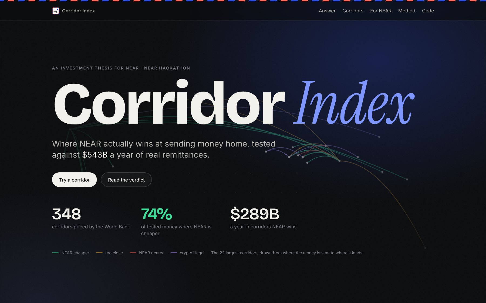
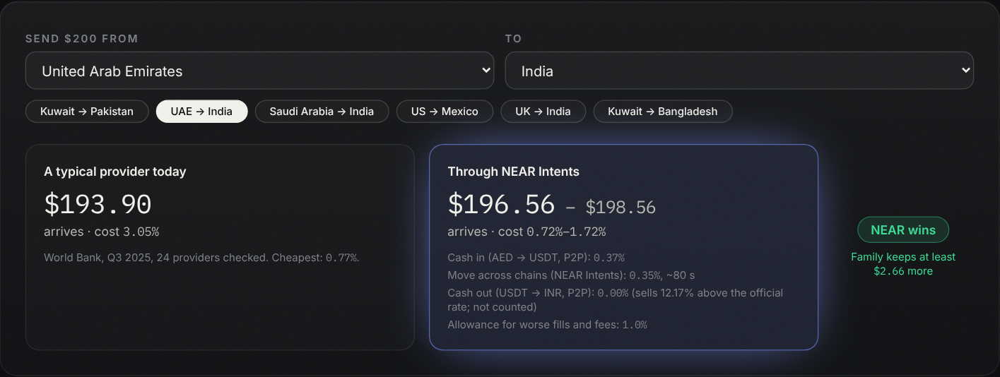
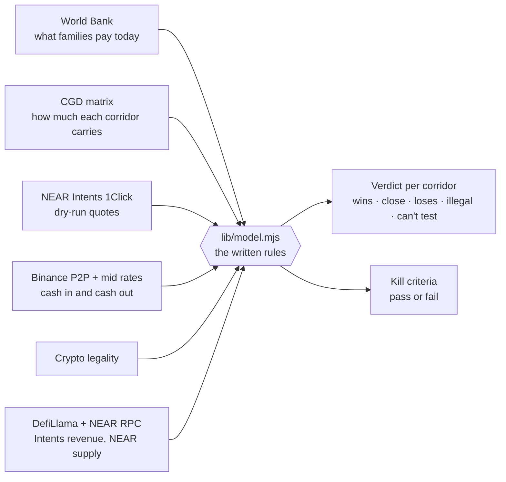
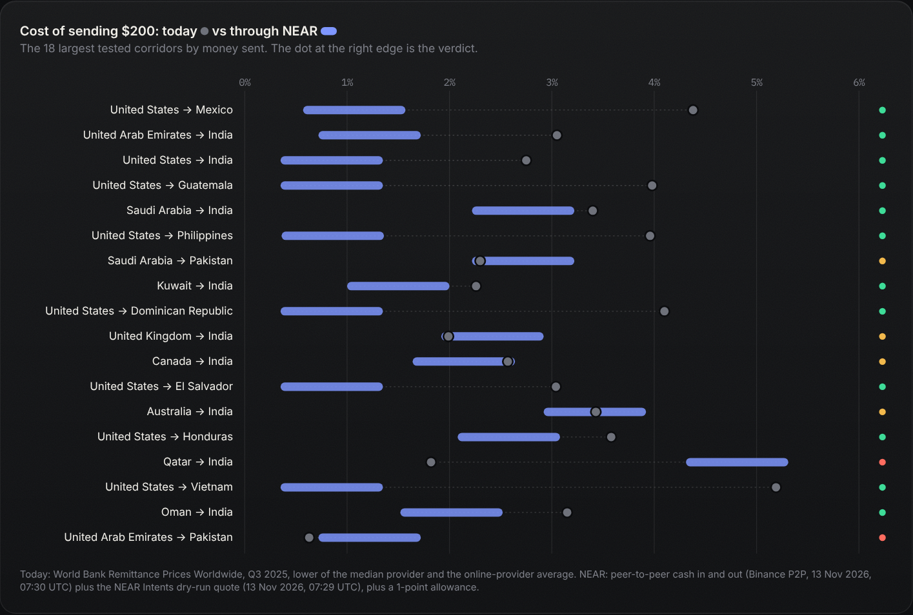

<p align="center">
  
</p>

<h1 align="center">Corridor Index</h1>

<p align="center"><b>Where NEAR actually wins at sending money home.</b> A re-runnable investment thesis for NEAR, built at NEAR HACKATHON for the <b>Investment Thesis</b> track.</p>

<p align="center">
  <a href="https://corridor-index.vercel.app"></a>
  <a href="data/thesis.json"></a>
  <a href="#how-every-number-is-made"></a>
  <a href="LICENSE"></a>
</p>

<p align="center">
  
</p>

Most NEAR theses measure the chain from the inside: transactions, NEAR Intents volume, fees against inflation. This one tests NEAR against a real market. Migrants send about $900 billion home every year. For each of the 348 corridors the World Bank prices, it compares what a family receives today with what it would receive if the money went through NEAR Intents, including the cost of turning local cash into dollars and back again.

- **Live site:** https://corridor-index.vercel.app
- **All numbers:** [`data/thesis.json`](data/thesis.json) · [`public/data/corridors.csv`](public/data/corridors.csv)

## The answer (first live run, 13 Nov 2026)

The site and [`data/thesis.json`](data/thesis.json) always show the latest daily run; the numbers below are from the first one.

| | |
| --- | --- |
| Corridors priced by the World Bank | 348, carrying $543B a year |
| Corridors we could test | 187, carrying $391B a year |
| **NEAR is cheaper** | **127 corridors, $289B a year (74% of tested money)** |
| Too close to call | 14 corridors, $51B |
| NEAR is more expensive | 46 corridors, $51B (for example Kuwait → Pakistan and UAE → Pakistan) |
| Crypto illegal at one end | 46 corridors, $73B (for example anything to Bangladesh, Egypt, Nepal, Morocco) |
| Can't test (no public peer-to-peer market) | 115 corridors, $80B |
| Money families would keep if every winning corridor switched | $5.6B a year |
| NEAR Intents protocol revenue if 10% of winning corridors switched | about $8M a year, **7.2%** of NEAR's yearly new supply ($116M) |

**Thesis:** NEAR's route is genuinely cheaper for most of the money we can test, so remittances could multiply NEAR Intents' usage many times over: the winning corridors carry about 9× what Intents moved in the last year. But only a small share of what users pay reaches the NEAR protocol, so remittances make NEAR *useful* long before they make the token *scarce*.

**Kill criteria, written before the data was pulled** (both re-check on every run):

1. NEAR must win at least **25%** of the tested money. Result: **74%**, passes.
2. At 10% adoption of the winning corridors, NEAR Intents protocol revenue must cover at least **5%** of NEAR's yearly new supply. Result: **7.2%**, passes, narrowly.

## Try it (do X, see Y)

<p align="center"></p>

1. Open https://corridor-index.vercel.app. You see a calculator set to **Kuwait → Pakistan**, with a red **NEAR loses** pill: the median provider already charges −0.39% (World Bank, Q3 2025), and NEAR's route costs more than that.
2. Click **UAE → India**. You see **NEAR wins**: about $196–$198 arrives through NEAR against $193.90 today, the cost broken into cash in, NEAR Intents and cash out, and how much more the family keeps per $200. Below it is a live NEAR Intents quote, fetched from the 1Click API when the page loads.
3. Scroll to **Every corridor** and drag the **stress-test** slider from 1.0 to 3.0 points. You see the count of winning corridors and the share of tested money fall as NEAR is given a worse deal. That is the bear case, made adjustable.
4. Click **Crypto illegal** or **Can't test**. You see every corridor that was left out, with the reason.
5. In **Is it worth it for NEAR?**, drag the adoption slider. You see the extra protocol revenue next to today's Intents revenue and NEAR's yearly new supply.
6. Click **Corridors (CSV)** in the footer. You get every corridor with its sources, ready for a spreadsheet.

## How every number is made



Run it yourself:

```
git clone https://github.com/farazeool/corridor-index
cd corridor-index
npm install
npm run fetch    # pulls every source below into data/raw (needs internet)
npm run thesis   # rebuilds data/thesis.json and prints the verdict
npm test         # 6 tests of the rules
npm run dev      # the site, on http://localhost:3000
```

`npm run thesis` needs no network: it rebuilds everything from the files in `data/raw`, which are committed. A GitHub Action (`.github/workflows/rerun.yml`) runs `fetch` and `thesis` every day and commits the new data. If a source fails, its previous file is kept and the run says so.

| What | Source | File |
| --- | --- | --- |
| What families pay today | World Bank, [Remittance Prices Worldwide](https://datacatalog.worldbank.org/search/dataset/0037898/Remittance-Prices-Worldwide), Q3 2025, cost of sending the equivalent of $200, about 6,500 provider quotes | `data/raw/rpw.json` |
| How much each corridor carries | Center for Global Development, [updated 2024 bilateral remittances matrix](https://www.cgdev.org/publication/geography-remittances-updated-global-bilateral-remittances-matrix) (Huckstep and Clemens, 2026) | `data/raw/volumes.json` |
| What NEAR Intents charges | NEAR Intents [1Click API](https://docs.near-intents.org), `POST /v0/quote` with `dry: true` (no money moves), $200 and $500 on 11 stablecoin routes | `data/raw/quotes.json` |
| Cash in and cash out | Binance P2P public USDT ads (median of the top five per side), against mid-market rates from ExchangeRate-API | `data/raw/p2p.json` |
| NEAR Intents volume, fees, revenue | DefiLlama fees and DEX APIs for `near-intents` | `data/raw/chain.json` |
| NEAR supply and inflation, NEAR price | NEAR mainnet RPC (`block`, `EXPERIMENTAL_protocol_config`), DefiLlama coins | `data/raw/chain.json` |
| Where crypto is illegal | Wikipedia, [Legality of cryptocurrency by country or territory](https://en.wikipedia.org/wiki/Legality_of_cryptocurrency_by_country_or_territory) | `data/raw/legality.json` |

### The rules (`lib/model.mjs`)

- **Today's cost** for a corridor is the *lower* of the median provider and the average online provider, so NEAR is always compared with the cheaper option.
- **NEAR's cost** = the premium paid to buy USDT with the sender's currency + the median NEAR Intents quote for $200 (0.35%) + any discount when selling USDT for the receiver's currency.
- When dollars sell *above* the official rate (India +12%, Pakistan +4%, Egypt +4% on 13 Nov), that premium is **ignored**, never counted as a gain. It is shown separately, as a sign of demand and a regulatory risk.
- **NEAR wins** only if its cost plus a 1-point allowance (worse fills, network fees) is still below today's cost. **NEAR loses** if its cost is above today's even before the allowance. Anything in between is **too close to call**.
- Corridors where crypto is illegal at either end, or where no public peer-to-peer market exists for one of the currencies, are **left out** of the verdict rather than guessed.
- Value to NEAR uses **protocol revenue** (DefiLlama "revenue"), not total fees, because most fees go to solvers and integrators.

<p align="center"></p>

## Limits

- Peer-to-peer markets are the weak link: counterparty risk, frozen bank transfers, and fills that worsen at scale. The top-five-ad median is a snapshot, not a guarantee.
- Corridor volumes are modelled by CGD from migrant stocks, not observed transactions.
- Prices are the World Bank's latest quarter (Q3 2025); the NEAR side is live. Incumbent prices keep falling.
- Binance P2P blocks some regions; when the daily job cannot reach it, the previous snapshot is kept and its date shown.
- Not investment advice.

## Repository

| Path | What it is |
| --- | --- |
| `lib/model.mjs` | The rules, the verdicts, the sizing and the kill criteria |
| `scripts/fetch.mjs` | Pulls every source into `data/raw` |
| `scripts/build.mjs` | Builds `data/thesis.json` and the public CSV from `data/raw` |
| `test/model.test.mjs` | Tests of the rules |
| `src/app` | The Next.js site; `src/app/api/quote` asks NEAR Intents for a live $200 quote |

## Built with

Next.js 16, React 19, Tailwind CSS 4, SheetJS (`xlsx`) for the World Bank and CGD workbooks, Instrument Sans, Newsreader and IBM Plex Mono (via Fontsource). Data from the World Bank, the Center for Global Development, NEAR Intents, Binance P2P, ExchangeRate-API, DefiLlama and NEAR RPC.

**AI assistance:** the code, the data pipeline and the copy were written with Claude (Anthropic) as a coding assistant, directed and checked by the authors.

**Our other NEAR HACKATHON project:** [Passpot](https://github.com/farazeool/Passpot), a rotating savings circle on NEAR (Social Money and Real-World Money tracks).

All code was written during the hackathon.

## License

MIT, see [LICENSE](LICENSE).
