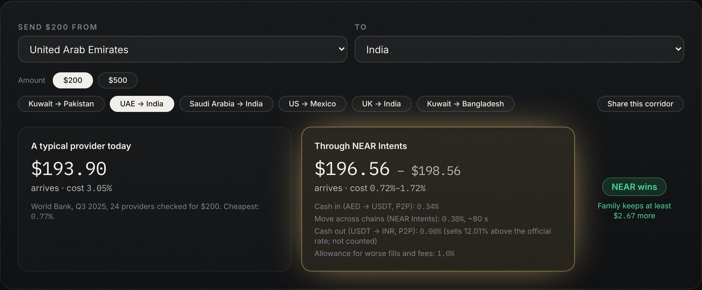
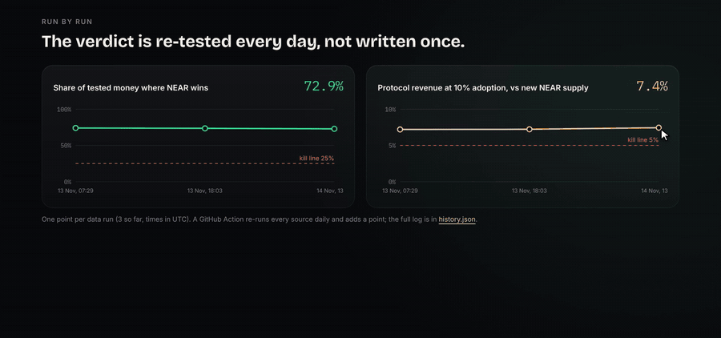
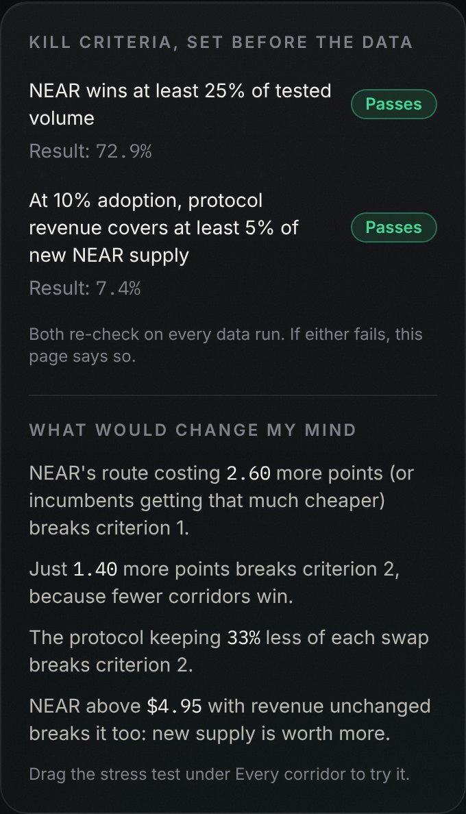
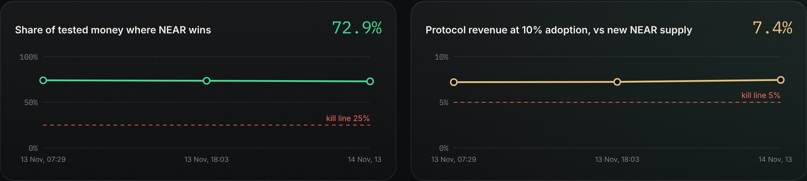
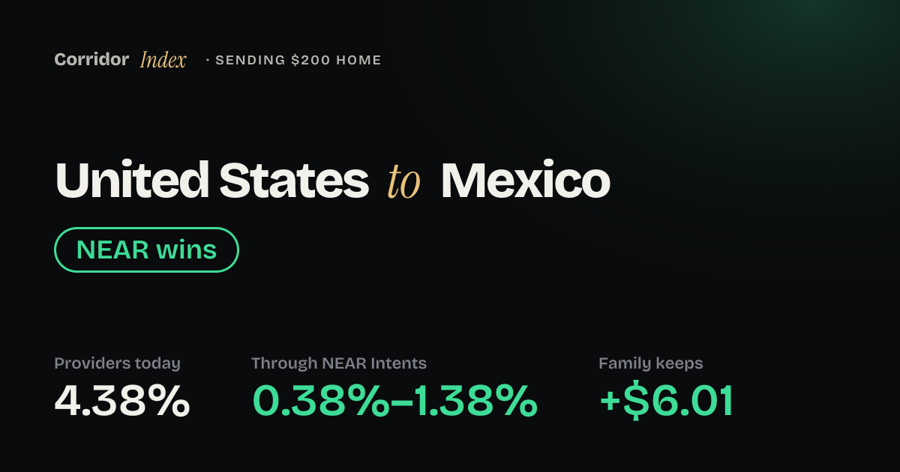
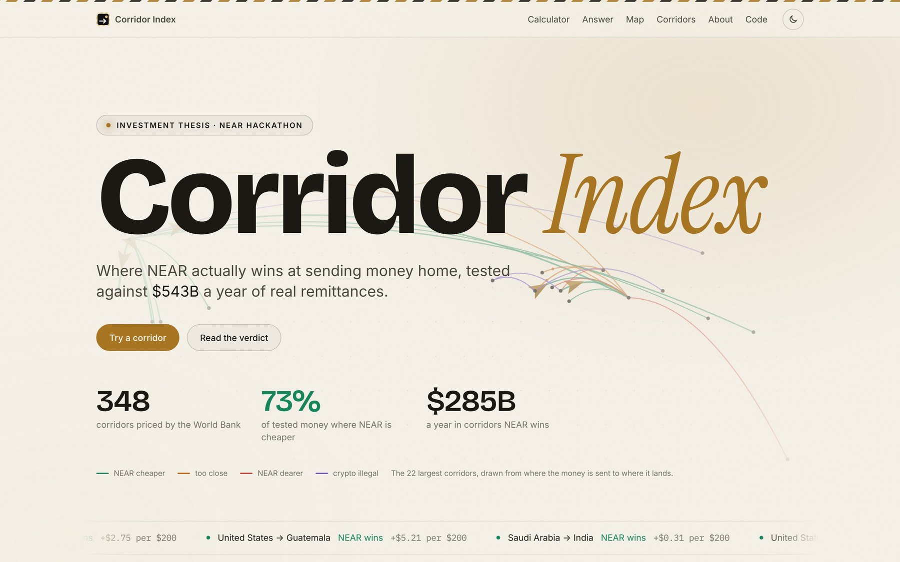
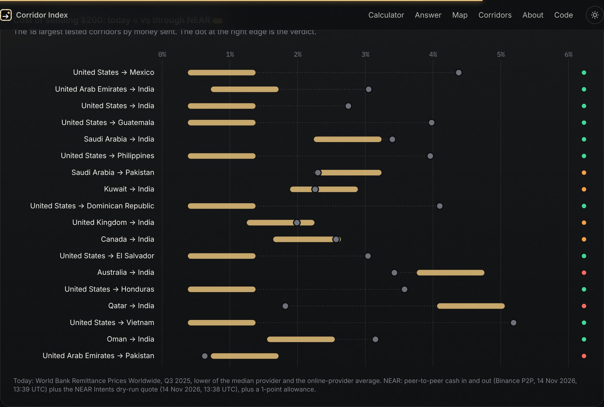
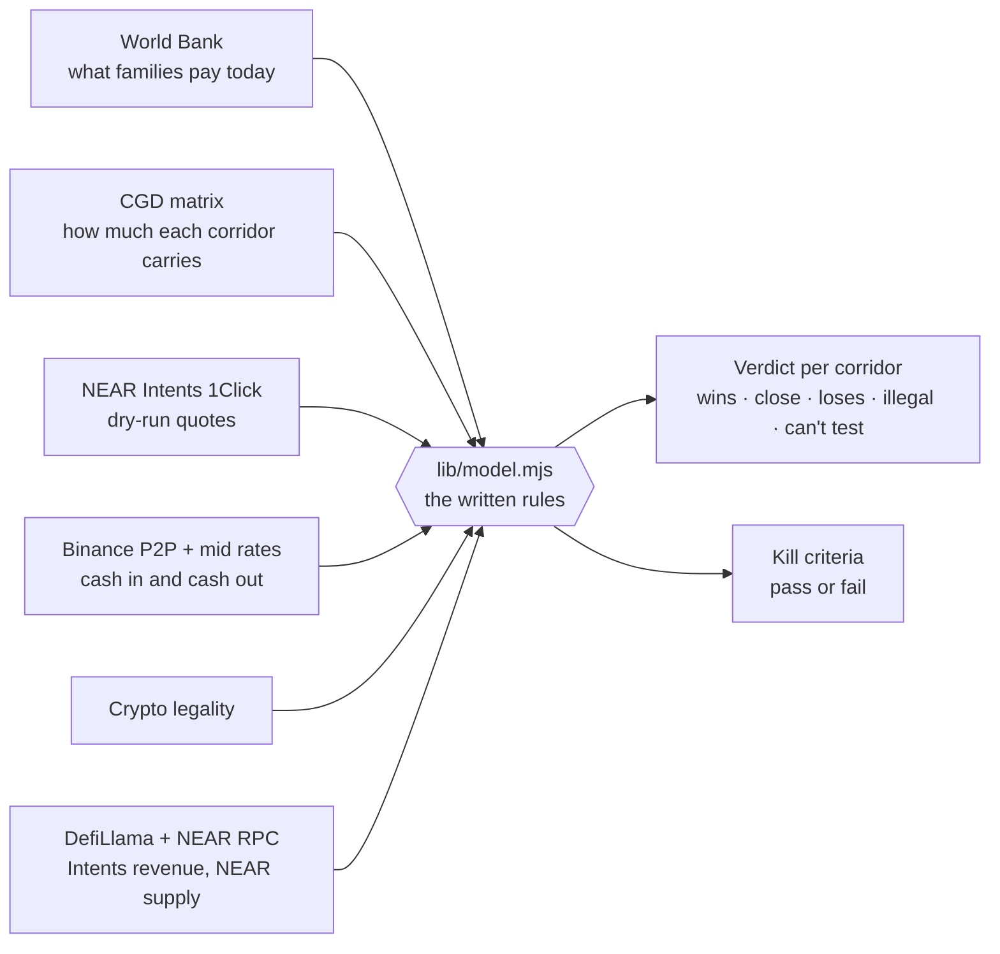

<p align="center">
  
</p>

<h1 align="center">Corridor Index</h1>

<p align="center"><b>Where NEAR actually wins at sending money home.</b><br>A re-runnable investment thesis for NEAR, built at NEAR HACKATHON for the <b>Investment Thesis</b> track.</p>

<p align="center">
  <a href="https://corridor-index-near.vercel.app"></a>
  <a href="https://github.com/farazeool/corridor-index/actions/workflows/rerun.yml"></a>
  <a href="data/thesis.json"></a>
  <a href="#tested"></a>
  <a href="LICENSE"></a>
</p>
<p align="center">
  
  
  
  
  
</p>

<p align="center">
  <a href="https://corridor-index-near.vercel.app"><b>Open the live site</b></a> ·
  <a href="#try-it-in-two-minutes"><b>Try it in two minutes</b></a> ·
  <a href="#how-every-number-is-made"><b>How every number is made</b></a> ·
  <a href="public/data/corridors.csv"><b>Every corridor (CSV)</b></a>
</p>

<p align="center">
  <a href="https://corridor-index-near.vercel.app"></a>
</p>

Most NEAR theses measure the chain from the inside: transactions, NEAR Intents volume, fees against inflation. **This one tests NEAR against a real market.** Migrants send about $900 billion home every year. For each of the 348 corridors the World Bank prices, Corridor Index compares what a family receives today with what it would receive if the money went through NEAR Intents, including the cost of turning local cash into dollars and back again. Then it asks whether any of that reaches the NEAR token, and it re-runs every day.

<table>
  <tr>
    <td align="center" width="25%"><h2>73%</h2>of the tested money is cheaper to send through NEAR</td>
    <td align="center" width="25%"><h2>$285B</h2>a year flows through the 128 corridors where NEAR wins</td>
    <td align="center" width="25%"><h2>$5.9B</h2>a year families would keep if those corridors switched</td>
    <td align="center" width="25%"><h2>7.4%</h2>of NEAR's new supply covered by protocol revenue at 10% adoption</td>
  </tr>
</table>

<p align="center"><sub>Latest daily run, 14 Nov 2026. The site and <a href="data/thesis.json"><code>data/thesis.json</code></a> always show the newest run.</sub></p>

### Live verdicts

These badges come straight from the site and update with every daily run. Any corridor's badge can be embedded the same way.

<p>
  <a href="https://corridor-index-near.vercel.app/c/usamex"></a>
  <a href="https://corridor-index-near.vercel.app/c/areind"></a>
  <a href="https://corridor-index-near.vercel.app/c/usaind"></a>
  <a href="https://corridor-index-near.vercel.app/c/sauind"></a>
  <a href="https://corridor-index-near.vercel.app/c/kwtpak"></a>
  <a href="https://corridor-index-near.vercel.app/c/saubgd"></a>
</p>

## The answer

| | Latest run (14 Nov 2026) |
| --- | --- |
| Corridors priced by the World Bank | 348, carrying $543B a year |
| Corridors we could test | 187, carrying $391B a year |
| **NEAR is cheaper** | **128 corridors, $285B a year (72.9% of the tested money)** |
| Too close to call | 15 corridors, $53B |
| NEAR is more expensive | 44 corridors, $53B (for example Kuwait → Pakistan, UAE → Pakistan, Australia → India) |
| Crypto illegal at one end | 46 corridors, $73B (for example anything to Bangladesh, Egypt, Nepal, Morocco) |
| Can't test (no public peer-to-peer market) | 115 corridors, $80B |
| Money families would keep if every winning corridor switched | $5.9B a year |
| NEAR Intents protocol revenue if 10% of winning corridors switched | about $8M a year, **7.4%** of NEAR's yearly new supply ($109M) |
| At $500 instead of $200 | NEAR is cheaper for 62% of the tested money (108 corridors) |

> **Thesis.** NEAR's route is genuinely cheaper for most of the money we can test, so remittances could multiply NEAR Intents' usage many times over: the winning corridors carry about 8.6× what Intents moved in the last year. But only a small share of what users pay reaches the NEAR protocol, so **remittances make NEAR useful long before they make the token scarce.**

**Kill criteria, written before the data was pulled.** Both re-check on every run, and the site says so if either fails.

| Criterion | Line | Latest | |
| --- | --- | --- | --- |
| NEAR wins this share of the tested money | at least 25% | 72.9% | ✅ passes |
| At 10% adoption, protocol revenue covers this share of NEAR's yearly new supply | at least 5% | 7.4% | ✅ passes, narrowly |

**What would change our mind** (shown next to the kill criteria, recomputed every run): NEAR's route costing **2.6** more percentage points breaks criterion 1; just **1.4** more points breaks criterion 2; so does the protocol keeping **33%** less of each swap, or NEAR trading above **$4.95** with revenue unchanged.

## What you can do on the site

<table>
  <tr>
    <td width="50%"><br><b>Calculator.</b> Any of 348 corridors at $200 or $500: today's price, NEAR's route broken into cash in, NEAR Intents and cash out, a live 1Click quote, and the verdict.</td>
    <td width="50%"><br><b>World map.</b> Every country coloured by where its money lands. Hover for the numbers, click for its corridors, flip between money arriving and money sent.</td>
  </tr>
  <tr>
    <td><br><b>Kill criteria and what would change our mind.</b> Pass or fail, and exactly how far each input has to move to flip it.</td>
    <td><br><b>Run by run.</b> A GitHub Action re-tests the thesis daily; each run adds a point against the kill lines (<a href="data/history.json"><code>history.json</code></a>).<br><br><br><b>Share cards and badges.</b> Every corridor has its own page (<code>/c/usamex</code>), a preview image for X and WhatsApp, and an embeddable SVG badge.</td>
  </tr>
  <tr>
    <td colspan="2"> <br><b>Light and dark themes</b>, and <b>every corridor</b> in one sortable, searchable table with a stress-test slider: the bear case, made adjustable.</td>
  </tr>
</table>

## Try it in two minutes

1. Open **https://corridor-index-near.vercel.app** and click **Try a corridor**. The calculator opens on **Kuwait → Pakistan** with a red **NEAR loses**: the median provider already charges −0.39% (World Bank, Q3 2025), and NEAR's route costs more.
2. Click **UAE → India**. **NEAR wins**: about $196–$198 arrives through NEAR against $193.90 today. Switch to **$500** to see the gap narrow. Click **Share this corridor** and paste the link anywhere: it unfurls with that corridor's verdict.
3. Under **The answer**, read the kill criteria, **What would change my mind**, and **Run by run**.
4. In **The map**, click India, then flip to **Money sent from** and click Saudi Arabia.
5. In **Every corridor**, drag the **stress test** from 1.0 to 3.0 points and watch the winning share fall. Click **Crypto illegal** or **Can't test** to see what was left out, and why.
6. Click **About**, and in **Is it worth it for NEAR?** drag the adoption slider.
7. Open any corridor page, for example [`/c/areind`](https://corridor-index-near.vercel.app/c/areind), and copy its **badge**. Click the sun icon for the **light theme**.

## How every number is made



Run it yourself:

```
git clone https://github.com/farazeool/corridor-index
cd corridor-index
npm install
npm run fetch    # pulls every source below into data/raw (needs internet)
npm run thesis   # rebuilds data/thesis.json and prints the verdict
npm test         # 7 tests of the rules
npm run build && npm start   # then, in another terminal:
BASE=http://localhost:3000 npm run e2e   # 48 end-to-end checks (needs Playwright)
npm run dev      # the site, on http://localhost:3000
```

`npm run thesis` needs no network: it rebuilds everything from the files in `data/raw`, which are committed. A GitHub Action (`.github/workflows/rerun.yml`) runs `fetch` and `thesis` every day and commits the new data. If a source fails, its previous file is kept and the run says so.

| What | Source | File |
| --- | --- | --- |
| What families pay today | World Bank, [Remittance Prices Worldwide](https://datacatalog.worldbank.org/search/dataset/0037898/Remittance-Prices-Worldwide), Q3 2025, cost of sending the equivalent of $200, about 6,500 provider quotes | `data/raw/rpw.json` |
| How much each corridor carries | Center for Global Development, [updated 2024 bilateral remittances matrix](https://www.cgdev.org/publication/geography-remittances-updated-global-bilateral-remittances-matrix) (Huckstep and Clemens, 2026) | `data/raw/volumes.json` |
| What NEAR Intents charges | NEAR Intents [1Click API](https://docs.near-intents.org), `POST /v0/quote` with `dry: true` (no money moves), $200 and $500 on 11 stablecoin routes | `data/raw/quotes.json` |
| Cash in and cash out | Binance P2P public USDT ads (median of the top five per side), against mid-market rates from ExchangeRate-API | `data/raw/p2p.json` |
| NEAR Intents volume, fees, revenue | DefiLlama fees and DEX APIs for `near-intents` | `data/raw/chain.json` |
| NEAR supply and inflation, NEAR price | NEAR mainnet RPC (`block`, `EXPERIMENTAL_protocol_config`), DefiLlama coins | `data/raw/chain.json` |
| Where crypto is illegal | Wikipedia, [Legality of cryptocurrency by country or territory](https://en.wikipedia.org/wiki/Legality_of_cryptocurrency_by_country_or_territory) | `data/raw/legality.json` |

### The rules (`lib/model.mjs`)

- **Today's cost** for a corridor is the *lower* of the median provider and the average online provider, so NEAR is always compared with the cheaper option.
- **NEAR's cost** = the premium paid to buy USDT with the sender's currency + the median NEAR Intents quote for $200 (about 0.4%) + any discount when selling USDT for the receiver's currency.
- When dollars sell *above* the official rate (India +12%, Pakistan +4%, Egypt +4% on 13 Nov), that premium is **ignored**, never counted as a gain. It is shown separately, as a sign of demand and a regulatory risk.
- **NEAR wins** only if its cost plus a 1-point allowance (worse fills, network fees) is still below today's cost. **NEAR loses** if its cost is above today's even before the allowance. Anything in between is **too close to call**.
- Corridors where crypto is illegal at either end, or where no public peer-to-peer market exists for one of the currencies, are **left out** of the verdict rather than guessed.
- Value to NEAR uses **protocol revenue** (DefiLlama "revenue"), not total fees, because most fees go to solvers and integrators.

<p align="center"></p>

## Tested

- `npm test`: 7 unit tests of the rules in `lib/model.mjs` (verdict boundaries, the ignored off-ramp premium, the $500 test, the kill criteria).
- `npm run e2e`: 48 end-to-end checks against the built site: every route and data file, the calculator, sharing, the $500 switch, the map, the stress test, tabs and search, the theme switch, corridor pages and badges, the About sliders, every internal link, mobile layout with no sideways scrolling, and no page errors. All 48 pass.

## Limits

- Peer-to-peer markets are the weak link: counterparty risk, frozen bank transfers, and fills that worsen at scale. The top-five-ad median is a snapshot, not a guarantee.
- Corridor volumes are modelled by CGD from migrant stocks, not observed transactions.
- Prices are the World Bank's latest quarter (Q3 2025); the NEAR side is live. Incumbent prices keep falling.
- Binance P2P blocks some regions; when the daily job cannot reach it, the previous snapshot is kept and its date shown.
- Not investment advice.

## Repository

| Path | What it is |
| --- | --- |
| `lib/model.mjs` | The rules, the verdicts, the sizing and the kill criteria |
| `scripts/fetch.mjs` | Pulls every source into `data/raw` |
| `scripts/build.mjs` | Builds `data/thesis.json`, the public CSV, and appends the run to `data/history.json` |
| `scripts/world.mjs` | Builds the world map outlines (Natural Earth 1:110m via `world-atlas`) |
| `src/lib/mind.ts` | How far each input must move before a kill criterion fails |
| `test/` | Unit tests of the rules and the end-to-end checks |
| `src/app` | The Next.js site: home (calculator, answer, map, corridors), `/about` (value for NEAR, bear case, method), `/privacy`, `/c/<corridor>` (one page and share image per corridor), `/badge/<corridor>.svg` (embeddable verdict); `src/app/api/quote` asks NEAR Intents for a live $200 quote |
| `.github/workflows/rerun.yml` | The daily re-run |

## Built with

Next.js 16, React 19, Tailwind CSS 4, d3-geo and world-atlas for the map, SheetJS (`xlsx`) for the World Bank and CGD workbooks, Bricolage Grotesque, Instrument Serif, Inter and IBM Plex Mono (via Fontsource). Data from the World Bank, the Center for Global Development, NEAR Intents, Binance P2P, ExchangeRate-API, DefiLlama and NEAR RPC.

**AI assistance:** the code, the data pipeline, the copy and the demo video were written with an AI coding assistant, directed and checked by the authors. The video's voiceover uses the open-source Kokoro text-to-speech model.

**Our other NEAR HACKATHON project:** [Passpot](https://github.com/farazeool/Passpot), a rotating savings circle on NEAR (Social Money and Real-World Money tracks).

All code was written during the hackathon.

## License

MIT, see [LICENSE](LICENSE).
